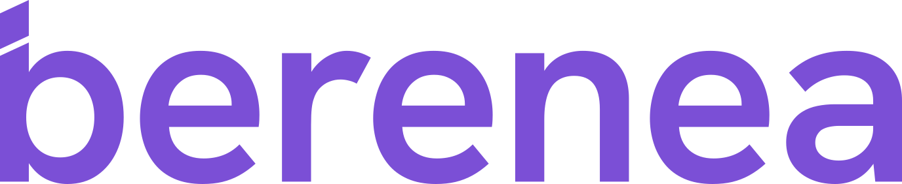

  <picture>
    <source media="(prefers-color-scheme: dark)" srcset="./berenea-logo-blanco.svg">
    
  </picture>

<h3 align="center">Toda tu consulta en una app</h3>

  Pacientes, agenda, dietas, entrenamientos, medidas y mensajes en un solo sitio. 
  Para nutricionistas y entrenadores. Tu paciente lo ve todo en su móvil.

  
  

---

## 💜 Quiénes somos

Somos **Berenea**, un equipo que construye software para profesionales de la salud y el deporte. Creemos que un nutricionista o un entrenador debería dedicar su tiempo a sus pacientes, no a pelearse con hojas de cálculo, WhatsApp y cinco aplicaciones distintas.

Por eso hacemos **una sola app para toda la consulta**: el profesional lo gestiona todo desde un sitio y su paciente lo sigue desde el móvil, gratis.

## 🧩 Qué hacemos

<table>
  <tr>
    <td width="50%" valign="top">
      <h4>👩‍⚕️ Para el profesional</h4>
      <ul>
        <li>Fichas de pacientes con etiquetas, alérgenos y hábitos</li>
        <li>Agenda con recordatorios automáticos</li>
        <li>Constructor de dietas con catálogo de alimentos y platos</li>
        <li>Constructor de entrenamientos con biblioteca de ejercicios</li>
        <li>Medidas antropométricas, objetivos y gráficas de evolución</li>
        <li>Chat en tiempo real con cada paciente</li>
        <li>Cobros a pacientes e informes en PDF</li>
        <li>Centros y equipos con varios profesionales</li>
      </ul>
    </td>
    <td width="50%" valign="top">
      <h4>📱 Para el paciente</h4>
      <ul>
        <li>Su plan del día: qué comer y qué entrenar</li>
        <li>Sus citas y la opción de pedir nuevas</li>
        <li>Su progreso con medidas y gráficas</li>
        <li>Pasos diarios desde Apple Health</li>
        <li>Chat directo con su profesional</li>
        <li>Y todo gratis: solo paga el profesional</li>
      </ul>
    </td>
  </tr>
</table>

## 🌍 En tu idioma

Berenea está disponible en **español, català, valencià, euskara, galego, English, français, Deutsch y português**.

## 🛠️ Con qué lo construimos

  
  
  
  
  
  
  
  
  
  
  

## 🔒 Privacidad y seguridad

Los datos de salud son delicados y los tratamos como tal: segundo factor de autenticación (correo o app TOTP), cifrado de contraseñas, control de acceso a cada archivo, protección antispam y copias de seguridad con plazos de conservación limitados, de acuerdo con nuestra política de privacidad.

## 📬 Hablemos

¿Eres nutricionista o entrenador y quieres probar Berenea? ¿Tienes una idea o has encontrado un fallo?
Escríbenos a **[hola@berenea.com](mailto:hola@berenea.com)** y te contestamos en el día.

---

  Hecho con 💜 en España

